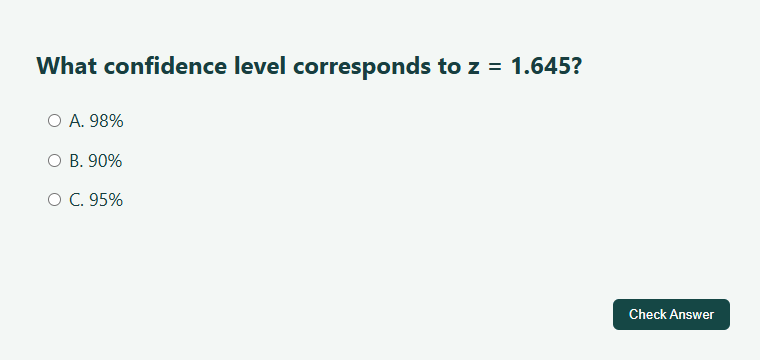

<h1 align="center">Auto-Pearson</h1>

<strong>An AI homework assistant for Pearson MyLab, built for Chrome.</strong> Made by Aahil Riyaz

<a href="https://github.com/Aahil-Riyaz/auto-pearson/releases/download/v0.6.1/auto-pearson-v0.6.1.zip"><strong>Download v0.6.1 (ZIP)</strong></a> &nbsp;·&nbsp; <a href="#install-and-run">Installation guide</a> &nbsp;·&nbsp; <a href="https://github.com/Aahil-Riyaz/auto-pearson/issues">Report a bug</a>

Auto-Pearson takes the question on your MyLab homework page, asks the AI chat you already have open, and fills the answer for you to review. Working through a multi-part problem? Enable automatic checking and the extension can follow **Next question** or **Continue** after MyLab confirms an answer.

*Demo from the Chrome navigation test. The extension runs on a simulated homework page with scripted AI replies.*

## Install and run

1. **Load the extension.** [Download the release ZIP](https://github.com/Aahil-Riyaz/auto-pearson/releases/download/v0.6.1/auto-pearson-v0.6.1.zip) and extract it. Open `chrome://extensions`, enable **Developer mode**, click **Load unpacked**, and select the inner **extension** folder containing `manifest.json`. Disable any older copy.
2. **Connect your chat.** Open a MyLab homework question and sign in to Gemini, ChatGPT, or DeepSeek in another tab. Refresh both tabs. With the homework visible, open Auto-Pearson from the Chrome toolbar, choose your assistant, and click **Test AI connection**.
3. **Try one question.** Leave **Pause before submitting** on and click **Start**. Review the filled answer before you click **Check Answer**. Use **Stop** in the popup to end the run.

## Choose how it runs

| If you want to… | In the extension popup |
| --- | --- |
| Review each answer yourself | Keep **Pause before submitting** on. |
| Include a graph or formula | Use **Preview full screenshot** to see what your chat would receive. Enable **Send screenshot with every question** to include it. |
| Send only question text | Turn **Send screenshot with every question** off. |
| Move through consecutive subparts | Turn **Pause before submitting** off and **Advance after checking** on. |

### What happens after “Fantastic!”?

MyLab can leave the old question and its **Check Answer** button visible behind a success message. Auto-Pearson v0.6.1 looks for the confirmation first, clicks the dialog’s navigation button, then waits for fresh answer controls. That lets it handle consecutive parts even when the question wording stays the same.

## Troubleshooting

| What you see | What to try |
| --- | --- |
| Chrome says the manifest is missing | Select the extracted **extension** folder itself. |
| The popup cannot find your homework | Open an individual MyLab homework question, refresh it, then reopen the popup from that tab. |
| The assistant does not respond | Confirm you are signed in to the selected chat, refresh it, and use **Test AI connection**. |
| A field or feedback dialog is unrecognized | Stop the run. [Open an issue](https://github.com/Aahil-Riyaz/auto-pearson/issues/new) with your Chrome version, assistant, and the exact button or feedback text. Omit private course details. |

## Privacy and compatibility

Screenshot mode sends the **entire visible homework tab** to the selected AI chat. Your name, course, and sidebar may be visible alongside the question. The provider handles the chat under your account settings. Use Auto-Pearson where your course permits AI assistance.

The extension targets MyLab **homework**. Custom math inputs, drag-and-drop exercises, and changes to chat interfaces can affect results. Tab, scripting, and navigation permissions let it locate homework frames and switch to the selected chat. Chrome sync stores preferences. The optional update check contacts GitHub.

<strong>What was tested in v0.6.1?</strong>

All 25 Node tests passed. Two Chrome simulations verified that the extension advances after “Fantastic!”, progresses through ten identically worded subparts, and skips AI requests on feedback screens. Authenticated course and provider sessions were outside these tests.

Run `node --test tests/*.test.js` from the repository root. For the Chrome simulations, install Python Playwright and Chromium, then run `python tests/fantastic-navigation-smoke.py` and `python tests/navigation-smoke.py`. Set `CHROMIUM_PATH` to use an existing Chromium executable.

## Development history

[Browse all eight original builds and their diffs](HISTORY.md), from the first homework toolbar to the multi-part navigation fixes in v0.6.1.

## Support Auto-Pearson

If Auto-Pearson helped you through a MyLab assignment, **star the repository** using the ★ Star button at the top of this page. If you hit a layout it can’t handle, a [bug report](https://github.com/Aahil-Riyaz/auto-pearson/issues/new) helps me reproduce it.

Made by **Aahil Riyaz**. Independent of Pearson and the AI providers. [Project website](https://aahil-riyaz.github.io/auto-pearson/) · [Third-party credits](NOTICE.md)
